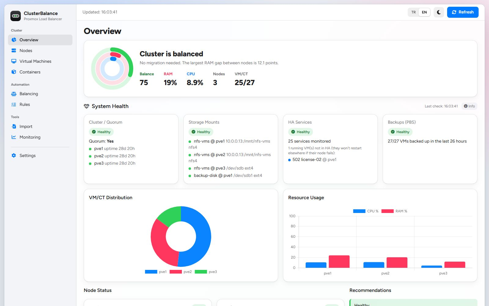
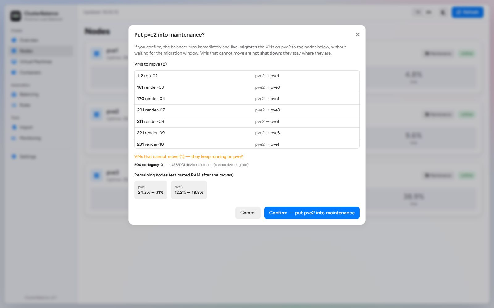
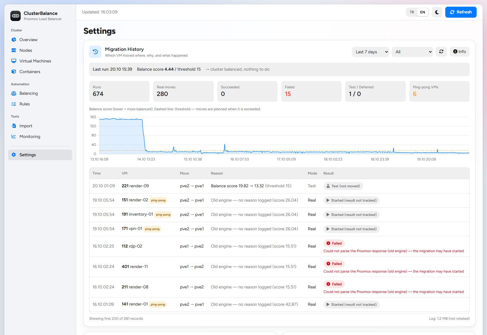
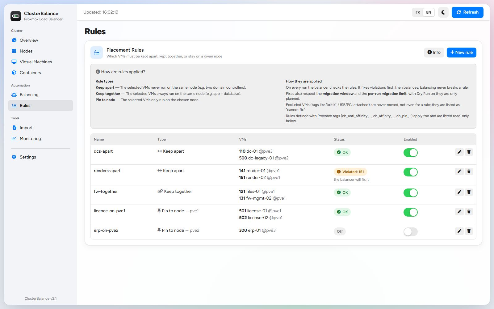
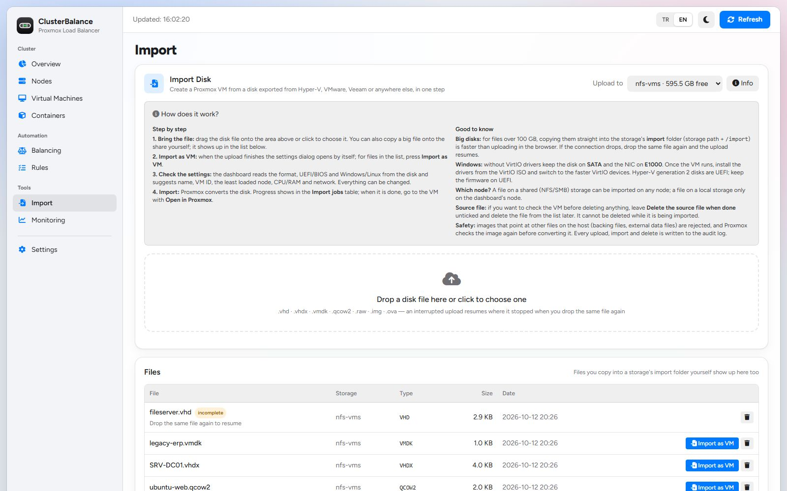
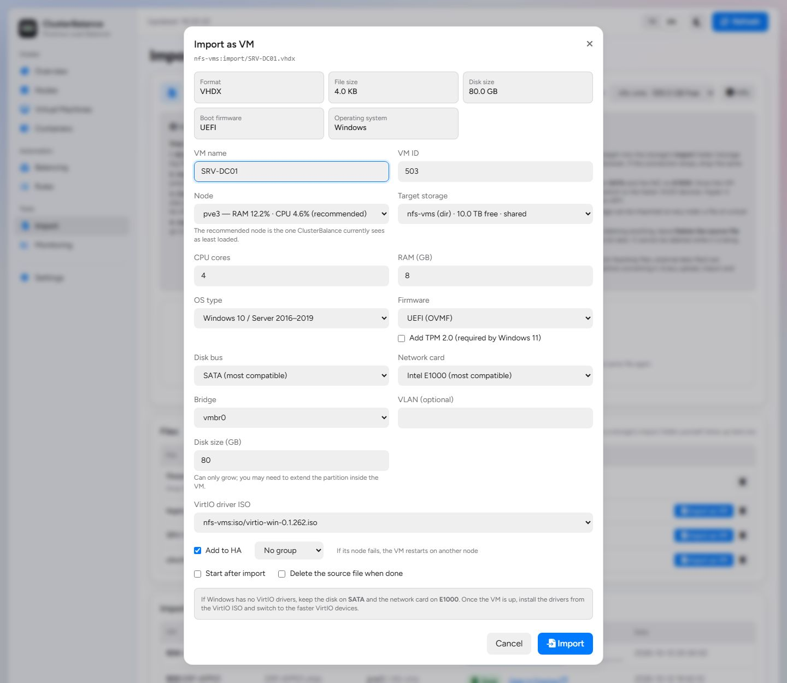

<p align="center"></p>

# ClusterBalance v2

**A safety-first load balancer, maintenance mode and health dashboard for Proxmox VE clusters.**

[](https://github.com/muammer-yesilyagci/clusterbalance/actions/workflows/ci.yml)
[](LICENSE)


🇹🇷 [Türkçe README](README.tr.md)



ClusterBalance runs on one node of your Proxmox VE cluster. Every 15 minutes it measures how
evenly the nodes are loaded and, if the difference is too big, **live-migrates a few VMs** to even
it out — but only when the move is safe and actually helps. On top of that you get:

- a **maintenance mode** that drains a node before a reboot/upgrade and moves every VM back afterwards,
- **placement rules** from the dashboard: keep VMs apart, keep them together, or pin them to a node,
- **disk import**: drop a `.vhd`/`.vhdx`/`.vmdk`/`.qcow2`/`.raw`/`.ova` file on the dashboard and get a ready Proxmox VM,
- a **web dashboard** with cluster health, migration history and settings,
- a small **widget inside the Proxmox web UI**,
- a **health API** you can poll for e-mail/Teams/Slack alerts (an n8n workflow is included).

> The dashboard is available in **English and Turkish** (TR/EN switch in the header; defaults to your browser language).
> Adding a language is one block of strings in `dashboard/templates/index.html` — see [Contributing](#contributing).

### What's new in v2

Version 2 is a hardened, production-tested evolution of the original ClusterBalance by Cemal Demirci:
storage/HA-aware safety checks, simulated planning that stops ping-pong migrations, a migration window,
awaited migrations, maintenance mode with automatic return, a secured HTTPS dashboard with health cards and
migration history, and ready-made alerts.

| | |
|---|---|
| 🛡️ **Safety first** | Storage (shared + mounted on the target), HA group, USB/PCI and capacity checks before every move |
| 🧮 **Smarter planning** | Every move is simulated; it must really improve the balance — no more ping-pong |
| 🌙 **Migration window** | Real balancing moves only at night (`20:00-07:00` by default), each one awaited and verified |
| 🔧 **Maintenance mode** | Drain a node with one click, reboot safely, every VM goes back afterwards |
| 📏 **Placement rules** | Keep apart / keep together / pin to node — edited on the dashboard, violations fixed automatically |
| 🩺 **Health cards & alerts** | Quorum, storage mounts, HA, PBS backups, failed tasks; n8n e-mail on every change |
| 📜 **Migration history** | What moved, where, why, and whether it worked — with a balance-score chart |
| 🌍 **English & Turkish** | TR/EN switch in the dashboard |
| 🔒 **Secured dashboard** | HTTPS with the Proxmox certificate, login, dangerous endpoints removed |
| 📥 **Disk import** | Drag & drop a Hyper-V/VMware/Veeam disk (or pick it from a share) → a ready VM on the least loaded node |
| ✅ **Tested** | 170+ automated tests on an anonymized real cluster snapshot, CI on every push |

See the [CHANGELOG](CHANGELOG.md) for details.

---

## Contents

- [Why this project exists](#why-this-project-exists)
- [Features](#features)
- [How balancing works](#how-balancing-works)
- [Requirements](#requirements)
- [Installation](#installation)
- [Configuration](#configuration)
- [Dashboard](#dashboard)
- [Maintenance mode](#maintenance-mode)
- [Placement rules](#placement-rules)
- [Disk import](#disk-import)
- [Migration history](#migration-history)
- [Health API and alerts](#health-api-and-alerts)
- [API reference](#api-reference)
- [Security](#security)
- [Troubleshooting](#troubleshooting)
- [Upgrading and uninstalling](#upgrading-and-uninstalling)
- [Limitations and roadmap](#limitations-and-roadmap)
- [Credits](#credits) · [License](#license)

---

## Why this project exists

ClusterBalance started as an internal tool for a 3-node Proxmox VE cluster whose VM disks live on a
shared NFS storage. Running it in production for months taught us — sometimes the hard way — what an
automatic balancer must never do. Every safeguard in this repository comes from a real incident:

| What happened | What ClusterBalance does now |
|---|---|
| After a cluster-wide reboot two nodes silently failed to mount the shared NFS storage. Proxmox kept showing the storage as *active*, so for **three weeks HA could not fail over anything**, and the balancer kept trying to move VMs onto nodes that could not see their disks. | Before every migration it checks that **each disk of the VM is on storage that is enabled, shared and actually mounted on the target node**. The dashboard shows a mount-status card and the alert workflow e-mails you within 5 minutes. |
| The first version picked the three "largest" VMs and moved them all to the same node without re-calculating. It made **~7,000 migration attempts in a few months**, the same VMs bouncing back and forth between nodes. | Planning is **greedy and simulated**: after every planned move the node loads are recalculated, a move is only accepted if it lowers the imbalance by at least `min_improvement`, and the history view flags **ping-pong** VMs. |
| Migrations were started 5 seconds apart without waiting — effectively in parallel — and a "started" task was counted as a success. | Each migration is **awaited**: first the Proxmox task, then until the VM is really *running* on the target (works for HA-managed VMs too). Failures and timeouts are logged with the reason. |
| VMs were moved in the middle of the working day. | Balancing migrations only happen inside a **migration window** (default `20:00–07:00`). Maintenance moves are the only exception. |
| A VM with a USB licence dongle, a VM whose EFI disk was on node-local storage and a VM in a restricted HA group were candidates for migration. | **USB/PCI passthrough, local disks and restricted HA groups** are detected and never migrated. |
| The first dashboard had no login and could run root commands on all nodes from any browser tab. | Dashboard requires **login over HTTPS**, dangerous endpoints were removed, CORS is closed. |

We are publishing it because these lessons apply to any Proxmox cluster.

## Features

**Balancer** (`balancer/balancer.py`, systemd timer every 15 min)
- Node score from used memory, CPU, root disk and optional I/O (weights configurable), or assigned resources, or PSI.
- Greedy planning with simulation, `min_improvement`, `max_migrations` per run, migration window.
- Safety checks per VM and target node: shared + enabled + mounted storage, HA group restrictions, USB/PCI passthrough, overprovisioning protection.
- [Placement rules](#placement-rules) edited on the dashboard (keep apart / keep together / pin to node); violations are fixed before balancing and balancing never breaks a rule.
- Tag based rules: exclude (`kritik`, `critical`, `pinned`, `no-migrate`, `cb_ignore*`), pin to a node (`cb_pin_<node>`), affinity (`cb_affinity_<group>`) and anti-affinity (`cb_anti_affinity_<group>`).
- `dry_run` mode that only logs decisions — the default after installation.

**Maintenance mode**
- One click in the dashboard: preview → drain the node → *"node is empty, safe to reboot"* → exit → every VM moves back to where it was.
- Also drains VMs excluded from normal balancing (optional); VMs that cannot move are listed with the reason and **never shut down**.

**Dashboard** (`dashboard/app.py`, HTTPS, login)
- Health cards: quorum/nodes, shared-storage mounts per node, HA services, last PBS backup per VM, failed tasks.
- Migration history with reasons, results, duration, errors, balance-score chart and ping-pong detection.
- Settings (threshold, mode, max migrations, excluded tags, dry run), manual dry-run, raw log.
- Maintenance mode UI with preview.
- Rules page with live status of every rule.
- English and Turkish UI (TR/EN switch).

**Proxmox UI widget** — a small box in the Proxmox web interface with the cluster balance status and a link to the dashboard.

**Alerts** — `GET /api/health` returns one JSON document for the whole cluster; the included n8n workflow sends a clear HTML e-mail only when something changes (problem / warning / recovered).

| Maintenance preview | Migration history |
|---|---|
|  |  |

## How balancing works

Every run (default: every 15 minutes):

1. **Collect** nodes and guests with `pvesh get /cluster/resources`, storage definitions, HA groups/resources and the config of each VM.
2. **Score** each node. With the default `method: combined` and `mode: used`:

   ```
   node_score = memory_used% × memory_weight + cpu% × cpu_weight + rootdisk% × disk_weight (+ io_wait × io_weight)
   balanciness = max(node_score) − min(node_score)
   ```
3. If `balanciness <= balanciness_threshold` → nothing to do.
4. Otherwise **plan greedily**: for every candidate VM, pick the best allowed target node, simulate the move,
   and keep the move that reduces balanciness the most — if it reduces it by at least `min_improvement`.
   Apply it to the simulated state and repeat until balanced or `max_migrations` is reached.
5. **Execute** (only inside `migration_window`, unless `dry_run`): `pvesh create /nodes/<src>/qemu/<id>/migrate --target <dst> --online 1`,
   then wait for the task and for the VM to be *running* on the target (up to `migration_timeout`).

A VM is **never** a candidate if it is stopped, excluded by tag/ID/name, has USB/PCI passthrough, is pinned elsewhere,
or has any disk/ISO on storage that is local, disabled, not defined for the target, or **not mounted** on the target.
Targets in a restricted HA group, in maintenance, or that would exceed `max_memory_usage` are skipped.
The reasons are written to the log and shown in the dashboard ("why can't VM X move to node Y").

## Requirements

- Proxmox VE 8.x cluster (developed and used on 8.4), 2+ nodes.
- Shared storage for live migration (NFS, Ceph, iSCSI/LVM, …). Node-local disks are never migrated.
- On the node that runs ClusterBalance: `python3`, `python3-flask`, `python3-yaml` (installed by `install.sh` from the Debian repos),
  and root SSH between cluster nodes (standard in a Proxmox cluster — used for mount checks and the widget).

## Installation

On **one** Proxmox node, as root:

```bash
git clone https://github.com/muammer-yesilyagci/clusterbalance.git
cd clusterbalance
./install.sh            # balancer + dashboard
./install.sh --widget   # optional: also add the widget to the Proxmox web UI on all nodes
```

The installer:
- copies the balancer and the dashboard to `/opt/clusterbalance/`,
- creates `/opt/clusterbalance/config.yaml` from the example **with `dry_run: true`** (existing config is kept),
- asks for a dashboard username/password (stored as a werkzeug hash in `/etc/clusterbalance/dashboard-users`),
- installs `clusterbalance.service` + `clusterbalance.timer`, `clusterbalance-dashboard.service` and logrotate.

Then:

1. Open `https://<node-ip>:5000` (it uses the node's Proxmox certificate, so your browser shows the same warning as on `:8006`).
2. Watch **Settings → Migration history** for a day or two: every decision is visible, nothing is migrated in dry-run mode.
3. When you are happy with the decisions, switch **Dry Run** off in the dashboard.

Try a run by hand at any time — it never migrates in dry-run:

```bash
python3 /opt/clusterbalance/balancer.py --dry-run
```

## Configuration

`/opt/clusterbalance/config.yaml` — see [`balancer/config.example.yaml`](balancer/config.example.yaml) for all options.
The most important ones:

| Key | Default | Meaning |
|---|---|---|
| `enabled` | `true` | Master switch |
| `dry_run` | `true` | Only log what would be migrated |
| `method` | `combined` | `memory`, `cpu`, `disk`, `io` or `combined` |
| `mode` | `used` | `used` (actual usage), `assigned` (configured RAM/cores), `psi` (pressure stall info) |
| `memory_weight` / `cpu_weight` / `disk_weight` / `io_weight` | 2 / 1 / 1 / 1.5 | Weights in the node score |
| `balanciness_threshold` | `15` | Allowed score difference between nodes |
| `min_improvement` | `5.0` | A migration must reduce the difference by at least this much |
| `max_migrations` | `3` | Balancing migrations per run |
| `migration_window` | `20:00-07:00` | Real balancing migrations only in this window (`""` = always) |
| `migration_type` | `live` | `live` (online) or `offline` |
| `migration_timeout` | `900` | Seconds to wait for one migration |
| `exclude_tags` | `kritik, critical, pinned, no-migrate` | Proxmox tags excluded from balancing |
| `exclude_vmids` / `exclude_names` | `[]` | More exclusions |
| `maintenance_nodes` | `[]` | Nodes being drained (set from the dashboard) |
| `maintenance_include_excluded` | `true` | Also drain excluded VMs during maintenance |
| `rules` | `[]` | [Placement rules](#placement-rules) (normally edited on the Rules page) |
| `enforce_rules` | `true` | Fix rule violations automatically |
| `overprovisioning_protection` / `max_memory_usage` | `true` / `95` | Never push a node above this memory % |
| `with_local_disks` | `false` | Allow migrating VMs with local disks (not recommended) |

Tag prefixes (Proxmox VM tags): `cb_ignore…` (exclude), `cb_pin_<node>` (keep on node),
`cb_affinity_<group>` (keep together), `cb_anti_affinity_<group>` (keep apart).

Dashboard environment variables (set them in `clusterbalance-dashboard.service`):

| Variable | Default |
|---|---|
| `CB_DASHBOARD_PORT` | `5000` |
| `CB_USERS_FILE` | `/etc/clusterbalance/dashboard-users` |
| `CB_TLS_CERT` / `CB_TLS_KEY` | `/etc/pve/local/pve-ssl.pem` / `.key` |
| `CB_BACKUP_STORAGE` | first enabled PBS storage |
| `CB_HA_SKIP_TAGS` | `no-ha` (running VMs with this tag are not listed as "not in HA") |
| `CB_TASKS_IGNORE` | `vncproxy,vncshell,spiceproxy,spiceshell,termproxy,vncterm` (task types never reported) |
| `CB_BACKUP_SKIP_TAGS` | `temp,no-backup` (guests with these tags are not checked for backups) |
| `CB_FIRST_SEEN` | `/opt/clusterbalance/first_seen.json` (when the dashboard first saw each guest) |
| `CB_IMPORT_MAX_GB` | `4096` (largest accepted upload) |
| `CB_IMPORT_JOBS` | `/var/lib/clusterbalance/import-jobs.json` |
| `CB_DIR`, `CB_CONFIG`, `CB_LOG`, `CB_STATE_FILE` | `/opt/clusterbalance`, `…/config.yaml`, `/var/log/clusterbalance.log`, `…/maintenance_state.json` |

Add another dashboard user:

```bash
python3 -c "import getpass;from werkzeug.security import generate_password_hash as g;print('alice:'+g(getpass.getpass()))" >> /etc/clusterbalance/dashboard-users
```

## Dashboard

| Page | What you get |
|---|---|
| **Dashboard** | Health cards (with an ⓘ legend explaining the colours), cluster totals, VM distribution and resource charts |
| **Nodes** | Per-node CPU/RAM/disk and the **maintenance mode** buttons |
| **Virtual machines / Containers** | Guests with status, CPU, memory |
| **Rules** | **Placement rules**: keep VMs apart / together / on a node, with live status |
| **Import** | [Disk import](#disk-import): drop a disk file, get a VM |
| **Monitoring** | Cluster CPU/RAM/disk gauges |
| **Settings** | Balancer settings, manual dry-run, **migration history**, raw log |

Colour is only used when it means something: green/yellow/red = status, blue = actions, one colour per data series.

## Maintenance mode

**Nodes → Enter maintenance ("Bakıma al")**

1. **Preview** (≈40 s, read-only): which VM goes to which node, which VMs cannot move and why
   (e.g. *"USB/PCI device attached"*), and the estimated RAM of the remaining nodes.
2. **Confirm**: the node is added to `maintenance_nodes` and the balancer starts immediately. Maintenance moves
   ignore the migration window. A banner shows progress; when no VM is left it says the node is safe to reboot.
3. **Exit maintenance ("Bakımdan çıkar")**: every VM that was moved away is live-migrated **back to the original node**
   (tracked in `/opt/clusterbalance/maintenance_state.json`, retried up to 5 runs).

Rules: only one node at a time; VMs that cannot move keep running on the node and are **never shut down**;
every enter/exit is written to the journal as `AUDIT … <user>: …`.

Preview from the command line (does not write to the log):

```bash
python3 /opt/clusterbalance/balancer.py --maintenance-preview pve2
```

## Placement rules

**Rules** page: tell the balancer which VMs must be kept apart, kept together, or stay on one node — no Proxmox tags needed.

| Rule | Meaning | Example |
|---|---|---|
| **Keep apart** (`anti-affinity`) | The VMs never run on the same node | two domain controllers, two cluster members |
| **Keep together** (`affinity`) | The VMs always run on the same node | app server + its database |
| **Pin to node** (`pin`) | The VMs only run on the chosen node | licence dongle, special hardware |

How they are applied:

- Every run the balancer checks the rules. It **fixes violations first**, then balances — and a balancing move never
  breaks a rule (a pinned VM stays, a group is never split, apart-VMs never meet).
- Fixes are ordinary migrations: they respect the migration window, `max_migrations` and dry run.
- Excluded VMs (tags such as `kritik`, USB/PCI passthrough) are **never** moved, not even for a rule; they appear as
  "could not be fixed" with the reason.
- The page shows each rule's status (OK / violated) live, and the tag-based rules (`cb_pin_…`, `cb_affinity_…`,
  `cb_anti_affinity_…`) read-only.

Rules are stored in `config.yaml`, so they can also be written by hand or by automation:

```yaml
rules:
  - {name: dcs-apart, type: anti-affinity, vms: [110, 208]}
  - {name: app-with-db, type: affinity, vms: [131, 141]}
  - {name: erp-on-pve2, type: pin, vms: [131], node: pve2, enabled: false}
enforce_rules: true   # false = show violations but never move VMs for them
```



## Disk import

Moving from Hyper-V, VMware or a Veeam export to Proxmox usually means `qemu-img convert`, `qm disk import`
and a dozen settings by hand. The **Import** page does it in one go:

1. **Drop the disk file** on the page (or click to choose it). Supported: `.vhd`, `.vhdx`, `.vmdk`, `.qcow2`,
   `.raw`, `.img` and `.ova`. Big files are uploaded in 32 MB chunks; if the connection drops, drop the same file
   again and it **resumes where it stopped**. Files you copy onto the share yourself (e.g. a 500 GB disk with
   `rsync`) show up in the list too — no upload needed.
2. The dashboard **inspects the image**: real format (not just the extension), disk size, UEFI or BIOS and
   Windows or Linux (from the partition table). For an OVA, the CPU/RAM/firmware from its OVF are used.
3. A **settings dialog** opens with suggestions you can change: VM name (from the file name), next free VM ID,
   **the least loaded node** (the same load figures the balancer uses; nodes in maintenance are skipped),
   target storage, CPU, RAM, OS type, firmware (+ TPM for Windows 11), disk bus, network card, bridge, VLAN and
   the VirtIO driver ISO. Windows defaults to SATA + E1000 so it boots without VirtIO drivers.
4. **Import** creates the VM with `pvesh create /nodes/<node>/qemu … import-from=<file>`: Proxmox converts the
   disk itself and the job shows up in its task log. The page shows the progress (per disk for an OVA), the
   result and an *Open in Proxmox* link; optionally the VM is started and the source file deleted.

**Setup:** files live in the `import/` folder of a storage with the **Import** content type
(*Datacenter → Storage → Edit → Content*, Proxmox VE 8.2+). Use a **shared** storage (NFS/SMB) so the VM can be
created on any node; with a local storage the VM can only be created on the dashboard node.

**Safety:** file names are restricted (no paths, commas or `=`), uploads cannot leave the import folder, free space
is checked before an upload, and images that point at other files on the host (qcow2 backing files, external data
files, VMDK extents outside the folder) are rejected — Proxmox checks the image again as untrusted before
converting it. A file that is being imported cannot be deleted or imported twice. Every upload, import and delete
is written to the dashboard's audit log.



|  |
|---|

## Migration history

Settings → **Migration history** is built from `/var/log/clusterbalance.log` (and rotated copies). For each migration:
time, VM, source → target, **reason** (balance score before → after, maintenance, return after maintenance),
mode (real/test) and **result**:

| Result | Meaning |
|---|---|
| Success + duration | VM is running on the target |
| Failed / Timeout | With the error (e.g. *"VM was locked by a backup"*) |
| Deferred | Planned outside the migration window |
| Test | Dry-run: planned, not migrated |

Also: "last run" decision in plain words, summary counters, balance-score chart with the threshold line,
filters (real / test / failed / ping-pong) and a **ping-pong** badge for VMs moved back within 24 h or 3+ times.

## Health API and alerts

`GET /api/health` (login required) returns the state of the whole cluster in one call:

```json
{
  "cluster":  { "ok": true, "quorate": true, "nodes": [{ "name": "pve1", "online": true, "uptime": 2462400 }] },
  "storage":  { "ok": false, "items": [{ "storage": "nfs-vms", "node": "pve2", "mounted": false, "path": "/mnt/nfs-vms" }] },
  "ha":       { "ok": true, "total": 25, "bad": [] },
  "backups":  { "ok": true, "storage": "pbs", "total": 28, "newest_ok": 27, "problems": [], "uncovered": 0,
                "pending": [{ "vmid": 905, "name": "new-app", "reason": "first_backup_pending", "since_h": 3.2 }], "skipped": 0 },
  "tasks":    { "ok": true, "count": 0, "failed": [] },
  "time": "17:40:46"
}
```

Rules: a card is **bad** if quorum is lost or a node is offline; if a shared *dir* storage is not mounted on a node;
if an HA service is in `error/fence/recovery/freeze` or not running although requested; if a VM's last PBS backup
is older than 50 h (warning after 26 h) or missing; failed tasks of the last 24 h are listed unless they are console
sessions (`vncproxy`, `termproxy`, … — `CB_TASKS_IGNORE`) or a later success settled them (a VM's start/stop/shutdown
after a failed power task, or the same task type retried successfully on the same VM).

Backups in detail:

- **New VMs don't raise false alarms.** A VM without any backup that was created (Proxmox `ctime`) or first seen by
  the dashboard less than 26 h ago is listed as *waiting for its first backup* (`pending`) and keeps the card green;
  if it still has no backup after 26 h it becomes a problem.
- **VMs no backup job covers are always a problem** (`reason: "no_job"`), new or not — the enabled jobs under
  *Datacenter → Backup* are evaluated (all / VMID list / pool, node filter, exclude list).
- VMs tagged `temp` or `no-backup` are not checked (`CB_BACKUP_SKIP_TAGS`).

The HA card also lists, as information (no alarm, no e-mail), running VMs that are **not HA-managed** — they will not
restart on another node if theirs fails (`unprotected` in the API). Tag a VM `no-ha` to leave it out on purpose (`CB_HA_SKIP_TAGS`).

**n8n workflow** — [`alerts/n8n-health-alert.json`](alerts/n8n-health-alert.json):
polls `/api/health` every 5 minutes and sends an HTML e-mail **only when a state changes**
(`[SORUN]` / `[UYARI]` / `[DÜZELDİ]`), with what changed, what to do, and a status table.

1. n8n → create a *Basic Auth* credential with a dashboard user (create a dedicated one, e.g. `n8n`).
2. Import the workflow, set the URL (`https://YOUR-PVE-NODE:5000/api/health`), enable *Ignore SSL Issues*, choose your SMTP credential and e-mail addresses (also the panel URL at the top of the Code node).
3. Activate / publish the workflow.

Any other poller works too (Uptime Kuma keyword monitor, a cron + curl script, Zabbix HTTP agent …).

## API reference

All endpoints need HTTP Basic auth except `/api/widget-summary`.

| Endpoint | Description |
|---|---|
| `GET /api/health` | Cluster health (see above) |
| `GET /api/history?hours=168` | Migration history, runs, balance-score chart data |
| `GET /api/maintenance` | Maintenance state per node |
| `GET /api/maintenance/preview?node=X` | Drain preview (read-only) |
| `POST /api/maintenance/enter` `{"node":"X"}` | Put node into maintenance |
| `POST /api/maintenance/exit` `{"node":"X"}` | Leave maintenance and move VMs back |
| `GET/POST /api/config` | Read / change balancer settings |
| `GET /api/rules` | Rules with live status, tag rules, VM/node lists |
| `POST /api/rules` `{"rules":[…]}` | Replace the rule list (validated; errors as codes) |
| `GET /api/import/storages`, `/api/import/files` | Import-enabled storages; files in their `import/` folders (incl. unfinished uploads) |
| `POST /api/import/upload` `{"storage","file","size"}` → `PUT /api/import/upload?storage=&file=&offset=&size=` | Start/resume an upload, then send ≤ 64 MB chunks |
| `DELETE /api/import/file?storage=&file=[&partial=1]` | Delete an import file (or an unfinished upload) |
| `GET /api/import/inspect?storage=&file=` | Format, size, firmware/OS guess, safety check |
| `GET /api/import/options[?node=]` | Nodes + recommended node, storages, bridges, next VM ID, VirtIO ISOs |
| `POST /api/import/start` | Create the VM from the file (all fields validated; errors as codes) |
| `GET /api/import/jobs` | Import jobs with progress and result |
| `POST /api/proxmox/run-balance` | Run the balancer in dry-run now |
| `GET /api/proxmox/balance-status` | Last 50 log lines |
| `GET /api/summary`, `/api/nodes`, `/api/guests`, `/api/distribution`, `/api/top`, `/api/recommendations` | Data for the dashboard pages |
| `GET /api/widget-summary` | **No auth**, minimal counters for the Proxmox UI widget; CORS allowed only for `https://<cluster node>:8006` |

## Security

- The balancer and the dashboard run as **root** (they use `pvesh` and SSH to the other nodes). Treat the dashboard like the Proxmox UI: keep it on the management network, never expose it to the internet.
- The dashboard only works over HTTPS and every endpoint except the widget summary requires a login. There is no CORS for other origins.
- Passwords are stored as werkzeug hashes. Use a dedicated user for automation (n8n).
- The dashboard can change the balancer configuration and put nodes into maintenance — i.e. it can cause live migrations — and create VMs from disk images in the storages' `import/` folders. It cannot run arbitrary commands.
- Built-in Flask/werkzeug server: fine for a handful of admins; put it behind a reverse proxy if you need more.

## Troubleshooting

| Symptom | Check |
|---|---|
| Nothing is ever migrated | `dry_run` still on? Are you inside `migration_window`? Look at "last run" in Migration history — it states why (balanced / no move improves enough / VMs rejected with reasons). |
| "Storage not mounted" card is red | On that node: `findmnt <path>`; mount it and fix `/etc/fstab` (`_netdev,x-systemd.automount`). For `dir` storages also set `is_mountpoint` in Proxmox. |
| Dashboard does not start | `journalctl -u clusterbalance-dashboard -e` — usually a missing users file or certificate path. |
| Widget shows "Connection error" | Open the dashboard URL once in that browser and accept the certificate. |
| Widget disappeared after an upgrade | A `pve-manager` update replaces `index.html.tpl`; run `./install.sh --widget` again. |
| Migration history is empty | Is `/var/log/clusterbalance.log` written? `systemctl list-timers clusterbalance.timer` |

## Upgrading and uninstalling

Upgrade: `git pull && ./install.sh` (config and users are kept).

Uninstall:

```bash
systemctl disable --now clusterbalance.timer clusterbalance-dashboard.service
rm -f /etc/systemd/system/clusterbalance*.{service,timer} /etc/logrotate.d/clusterbalance
rm -rf /opt/clusterbalance /etc/clusterbalance
# widget, on every node:
sed -i '/clusterbalance.js/d' /usr/share/pve-manager/index.html.tpl; rm -f /usr/share/pve-manager/js/clusterbalance.js
```

## Limitations and roadmap

- One cluster per installation; the balancer runs on one node (if that node is down, balancing pauses — HA keeps working).
- Planned: English UI, per-node history graphs, non-root API token, N-1 capacity card, "movability" view per VM, rule editor for affinity tags.

## Contributing

Issues and pull requests are welcome. Please describe your cluster (Proxmox version, number of nodes, storage type)
when reporting balancing behaviour, and attach the relevant part of `/var/log/clusterbalance.log`.

### Running the tests

The test suite runs against an anonymized snapshot of a real 3-node cluster (`tests/fixtures/`) through a fake
`pvesh`, so it needs no Proxmox host and never touches one:

```bash
pip install flask pyyaml pytest
pytest tests            # balancer planning, safety checks, maintenance mode, dashboard API
node --test tests/*.test.mjs   # n8n alert node
```

Every push and pull request runs the same checks on GitHub Actions (plus `shellcheck` and JS syntax checks).

## Credits

- **Muammer Yeşilyağcı** ([@muammer-yesilyagci](https://github.com/muammer-yesilyagci)) — maintainer; ClusterBalance v2: safety checks, maintenance mode, health cards, migration history, alerts and documentation.
- **Cemal Demirci** ([@cemal-demirci](https://github.com/cemal-demirci)) — original author of ClusterBalance v1, the dashboard and the Proxmox widget; co-developed v2.

## License

[MIT](LICENSE)
